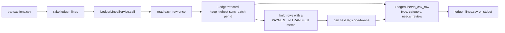

# ledger_lines

Turns a raw transaction feed (corporate card and bank account) into categorized ledger lines. The code is organized the way it would sit inside a Rails app (`app/models`, `app/services`, `lib/tasks`), with ActiveModel standing in for ActiveRecord so no database is needed.

## Dependencies

- Ruby 3.4.1 (pinned in `.ruby-version`; install with rbenv, asdf, or your version manager of choice)
- Bundler 2.x (`gem install bundler`)
- Gems, installed by Bundler from the `Gemfile`: `activemodel`, `bigdecimal`, `csv`, `rake`, and `minitest` (test only)

No database or other services are required.

## How to run it

```sh
bundle install
bundle exec rake "ledger_lines[<path_to_csv>]" > ledger_lines.csv
```

The task takes the path to a transactions CSV as its only argument and writes the ledger lines CSV to stdout. Running it again on the same feed produces identical output.

Run all the tests with:

```sh
bundle install && bundle exec rake test
```

## How it works



The rake task passes the CSV path to `LedgerLinesService.call`, which can equally be called from the app or a background job. The service reads the file once. Each row is recorded in the `Ledger` as a `LedgerLine`, replacing an earlier version of the same transaction id only if its `sync_batch` is higher. Rows whose memo mentions a payment or transfer are also held aside. Once the file is read, the held rows are paired with an opposite leg in the other account, one-to-one. Each line then works out its type (transfer, refund, deposit, otherwise purchase), its category from the merchant list, and whether it needs review, as the CSV is written.

### Time complexity

With n rows in the file and t rows whose memo mentions a payment or transfer:

| Step | Time |
|------|------|
| Read rows and keep the highest sync_batch per id | O(n) |
| Pair held transfer legs | O(t) expected; grouped by date and amount |
| Classify, categorize and write CSV | O(n); merchant lookups are cached per distinct merchant |

Overall O(n) time and O(u) memory, where u is the number of unique transaction ids.

## Further documentation

- [What I would ask before starting](doc/what_i_would_ask_before_starting.md): what was unclear or wrong in the story, with the interim decision made for each.
- [What I would do next](doc/what_i_would_do_next.md): follow-up work left out of this version.
- [What I did](doc/what_i_did.md): my part of the work, including where I directed and overrode the AI-generated code.
- [Original prompt](doc/ledger_lines_original_prompt.md): the prompt Claude Code worked from.

## Where I used AI

Claude Code wrote the tests and code test-first from my prompt, one commit per passing test during the initial build, working under Ponytail and a set of agent settings and skills I developed at my current company (listed in [What I did](doc/what_i_did.md#tools-i-used)). Separate Claude agents reviewed the work adversarially in three rounds: the classifier's edge cases, over-engineering (using Ponytail), and regressions from the single-pass refactor. Findings that were fixed were reproduced as failing tests first. Where I overrode or corrected it is in [What I did](doc/what_i_did.md).
